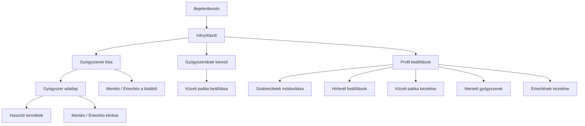

# BENU Orvosi Portál – Felületi funkciók összefoglalója

🔗 **A prototípus elérhetősége:** [https://bvorvosi.vercel.app](https://bvorvosi.vercel.app/)

> **Cél:** Ez a dokumentum a BENU Orvosi Portál prototípus összes felhasználói felületét és elérhető funkcióját mutatja be — közérthető nyelven, interjú forgatókönyv készítéséhez.
> 
> **Fontos:** Az adminisztrátori felületek **nem** részei ennek az összefoglalónak.

---

## 1. Bejelentkezés

🔗 [Megnyitás a prototípusban](https://bvorvosi.vercel.app/login)

A rendszer használatához a felhasználónak be kell jelentkeznie az e-mail címével és jelszavával.

**Elérhető funkciók:**
- E-mail cím és jelszó megadása
- „Bejelentkezés" gomb
- „Elfelejtett jelszó" hivatkozás
- Hibás adatok esetén hibaüzenet jelenik meg

Sikeres bejelentkezés után a felhasználó az **Irányítópultra** kerül.

---

## 2. Navigációs sáv (állandóan látható)

> A navigációs sáv minden oldalon látható, pl. 🔗 [Irányítópult](https://bvorvosi.vercel.app/dashboard)

A képernyő tetején egy állandó menüsor található, amely minden oldalról elérhető. Tartalmazza:

| Elem | Leírás |
|---|---|
| **Logo / „Orvosi Portál"** | Visszavisz az Irányítópultra |
| **Menüpontok** | Irányítópult · Gyógyszerek · Gyógyszertárak |
| **Közeli patika jelzés** | Ha be van állítva, a navigációs sávban látható a kiválasztott patika neve és címe. Rákattintva módosítható. |
| **Globális kereső** | Egy keresőmező, amelybe bármit beírva azonnal megjelennek a találatok gyógyszerek és gyógyszertárak között |
| **Mentett gyógyszerek ikon** | Könyvjelző ikon, mellette egy szám jelzi a mentett gyógyszerek számát. Rákattintva egy gyorslista jelenik meg a mentett gyógyszerekről. |
| **Profil menü** | A felhasználó nevének kezdőbetűi, rákattintva legördülő menü: Profil beállítások, Kijelentkezés |

### 2.1 Globális kereső – részletek

A keresőmezőbe gépelve azonnal megjelennek a találatok, típus szerint csoportosítva:
- **Gyógyszerek** – név és hatóanyag alapján keres
- **Gyógyszertárak** – név, település és cím alapján keres

A találatokra kattintva közvetlenül az adott elemre navigálhatunk.

### 2.2 Mobil nézet

Mobilon a menüpontok egy „hamburger" menü mögé kerülnek (három vízszintes csík ikon). Megérintve kinyílik a teljes menü.

---

## 3. Irányítópult (Kezdőoldal)

🔗 [Megnyitás a prototípusban](https://bvorvosi.vercel.app/dashboard)

Az Irányítópult a belépés utáni főoldal, amely két fő szekciót tartalmaz egymás mellett (asztalon), vagy egymás alatt (mobilon).

### 3.1 Készletváltozások

Az első oszlop a **gyógyszerkészletek legfrissebb változásait** mutatja:
- **Összegző doboz:** Hány készletváltozás történt a kiválasztott időszakban (pl. „Mai nap" vagy „Elmúlt 7 nap"), bontva: hány termék lett „megszűnt", „hiány" és „elérhető"
- **Legutóbbi 20 változás:** Táblázat, amely a legutóbbi 20 készletváltozást mutatja: státusz (színes jelzéssel), terméknév (kattintható link az adatlapra), dátum
- **„Összes változás" link:** A gyógyszerlista oldalra navigál, frissítés szerinti sorrenddel

### 3.2 Közeli patika készletváltozásai

A középső oszlop a **kiválasztott közeli patika** készletváltozásait mutatja:
- Ha van beállítva patika: megjeleníti a patika nevét, statisztikát (hány termék fogyott el / lett újra elérhető), és a legutóbbi változásokat táblázatban
- Ha nincs beállítva patika: egy interaktív térképet mutat, amelyen kiválasztható egy patika

### 3.3 Időszak választó

Az oldal tetején egy időszak-választó található, amellyel beállítható, hogy az adatok melyik időszakra vonatkozzanak (pl. 1 nap, 7 nap, 30 nap).

---

## 4. Gyógyszerek lista

🔗 [Megnyitás a prototípusban](https://bvorvosi.vercel.app/gyogyszerek)

Ez az oldal a rendszerben elérhető összes gyógyszert jeleníti meg **táblázatos nézetben**.

### 4.1 Keresés és szűrés

| Funkció | Leírás |
|---|---|
| **Szabad szöveges keresés** | Gyógyszer neve, hatóanyaga vagy TK-száma alapján keres (a táblázat felett, az oszlopszűrő sorban) |
| **Státusz szűrő** | Az „Elérhető", „Készlethiány" vagy „Megszűnt" közül választható (oszlopszűrő a státusz oszlopban) |
| **Mentett gyógyszerek szűrő** | „Mentett gyógyszerek" gomb — bekapcsolva csak a korábban elmentett gyógyszereket mutatja |
| **Közeli patikában elérhető** | Ha be van állítva közeli patika, egy gombbal szűrhetünk az ott elérhető termékekre |
| **Dátum szűrő** | Az „Utolsó frissítés" oszlopban dátumtartomány megadásával szűkíthető az időintervallum |

### 4.2 Rendezés

Az egyes oszlopok fejlécére kattintva az eredmények rendezhetők növekvő vagy csökkenő sorrendbe. Az aktuális rendezési irány ▲/▼ jelzéssel látható.

### 4.3 Oszlopok és nézet testreszabása

A **„Nézet"** gombra kattintva egy beállítási panel nyílik meg, ahol:
- Kiválasztható, mely oszlopok legyenek láthatók a táblázatban
- Az oszlopok sorrendje **húzd és ejtsd** (drag & drop) módszerrel átrendezhető a fejléc megragadásával

A beállítások megmaradnak az oldalfrissítések között is.

### 4.4 Műveletek minden terméknél

A táblázat jobb szélén, minden terméknél három művelet érhető el:

| Ikon/Gomb | Funkció |
|---|---|
| 📑 Könyvjelző | **Mentés** — A gyógyszer hozzáadása vagy eltávolítása a mentett listáról |
| 🔔 Csengő | **Értesítés** — Feliratkozás vagy leiratkozás értesítésekre (ha a gyógyszer készlete változik) |
| „Részletek" | Navigáció a gyógyszer részletes adatlapjára |

> **Fontos összefüggés:** Ha értesítést kérünk egy gyógyszerre, az automatikusan a mentett listára is kerül. Ha eltávolítunk egy mentett gyógyszert, amelyre értesítés is aktív, a rendszer figyelmeztetést jelenít meg.

### 4.5 Lapozás

Az eredmények 24 elemenként jelennek meg, az alján lapozó segítségével válthatunk az oldalak között.

---

## 5. Gyógyszer részletes adatlap

🔗 [Példa adatlap megnyitása](https://bvorvosi.vercel.app/gyogyszerek/OGYI-T-04283/01) *(bármely gyógyszer Részletek gombjára kattintva elérhető)*

Egy konkrét gyógyszerre kattintva megjelenik annak részletes adatlapja, amely az alábbi adatokat tartalmazza:

### 5.1 Alapadatok

- **Terméknév**, **TK-szám**
- **Státusz** (színes jelzéssel: zöld = elérhető, sárga = készlethiány, piros = megszűnt)
- **Közeli patika elérhetőség** (ha van beállítva közeli patika, mutatja, hogy ott elérhető-e)
- **Készletinformáció** (hány patikában elérhető az ország szerte)
- **Hatóanyag (INN)** — kattintható, rákattintva a hatóanyag alapján szűrt gyógyszerlistára navigál
- **Márkanév**, **ATC kód**, **Gyártó**, **Kiszerelés**, **Utolsó frissítés**

### 5.2 Készlethiány információ

Ha a termék készlethiányos, egy külön kiemelt blokkban jelennek meg:
- A hiány kezdete és tervezett vége
- A hiány oka
- Javaslat a hiánykészítmény pótlására (ha van ilyen)

### 5.3 Műveletek

- **Mentés** a mentett listához (könyvjelző ikon)
- **Értesítés kérése** (csengő ikon)
- **Vissza a listához** gomb a tetején

### 5.4 Hasonló termékek

Az adatlap alján megjelennek az **azonos hatóanyagú, elérhető** termékek listája, így a felhasználó könnyen talál alternatívát.

### 5.5 Státusz előzmények

Egy idővonal mutatja a gyógyszer korábbi státuszváltozásait (mikor volt elérhető, mikor lépett készlethiányba, stb.).

---

## 6. Gyógyszertárak keresése

🔗 [Megnyitás a prototípusban](https://bvorvosi.vercel.app/gyogyszertarak)

A gyógyszertárkereső felület egy **térkép és lista kombinációja**, amely segít a felhasználónak megtalálni a számára releváns gyógyszertárakat.

### 6.1 Felépítés

- **Bal oldali panel:** Gyógyszertárak listája kártyás formában
- **Jobb oldali panel:** Interaktív térkép jelölőkkel
- **Mobilon:** A „Lista" és „Térkép" nézet között váltó gombok segítségével lehet váltogatni

### 6.2 Keresés és szűrés

| Funkció | Leírás |
|---|---|
| **Keresőmező** | Név, cím vagy település alapján keres |
| **„Most nyitva"** | Csak a jelenleg nyitva tartó patikákat mutatja |
| **„Hétvégén nyitva"** | Hétvégén is nyitva tartó patikákat mutatja |
| **„0–24 órában nyitva"** | Éjjel-nappal nyitva tartó patikákat mutatja |

### 6.3 Térkép és lista összehangolása

- A listában kiválasztott patikára kattintva a térkép automatikusan a kiválasztott patikára fókuszál
- A lista valós időben csak azokat a patikákat mutatja, amelyek a térkép aktuálisan látható területén vannak
- A **„Mutasd az összest"** gomb visszaállítja a térképet az ország teljes nézetére

### 6.4 Patika kártya

Minden patika kártyáján az alábbi adatok láthatók:
- Patika neve, címe, telefonszáma
- Nyitvatartási információk
- **„Közeli patikám" beállítási lehetőség** (ház ikon), amellyel az adott patikát kiválaszthatja a felhasználó közeli patikaként

---

## 7. Profil beállítások

🔗 [Megnyitás a prototípusban](https://bvorvosi.vercel.app/profile)

A profil oldalon a felhasználó megtekintheti és kezelheti saját beállításait. Az oldal több szekcióra tagolódik:

### 7.1 Alapadatok

- **Név** – megtekinthető, de nem módosítható (az adminisztrációhoz kell fordulni)
- **E-mail cím** – az elsődleges bejelentkezési azonosító, nem módosítható
- **Másodlagos e-mail cím** – biztonsági mentés és értesítések céljára, nem módosítható
- **Szakterület(ek)** – módosítható, több szakterület is választható egy listából. A „Szerkesztés" gombra kattintva megjelenik egy kereséssel segített lista, ahol checkboxokkal jelölhetőek a szakterületek.

### 7.2 Közeli Patikám

Ezen a részen a felhasználó beállíthatja vagy módosíthatja a számára kiemelt közeli patikát:
- Ha van beállítva: megjelenik a patika neve, címe és telefonszáma, valamint egy „Módosítás" és „Törlés" gomb
- Ha nincs beállítva: egy tájékoztató szöveg és „Patika keresése" gomb jelenik meg, amely megnyitja a gyógyszertár-keresőt egy felugró ablakban

### 7.3 Hírlevél beállítások

A hírlevél beállítások **mindkét e-mail címre** (elsődleges és másodlagos) külön konfigurálhatók a készletinfó értesítések tekintetében:

#### Készletinfó értesítések
- Be-/kikapcsolható
- Ha bekapcsolt, további részletek állíthatók:
  - **Rendszeresség:** Napi, Heti vagy Havi
  - **Kiküldés ideje:** Melyik órában küldje a rendszer
  - **Téma:** Újra elérhető / Készlethiány / Megszűnt (több is választható)
  - **Témakör:** Minden / Szakterület + mentett gyógyszerek / Csak szakterület / Csak mentett gyógyszer

### 7.4 Biztonság

- **Jelszó módosítás** gomb – segítségével a felhasználó megváltoztathatja jelszavát

### 7.5 Kijelentkezés

Az oldal alján egy **„Kijelentkezés a rendszerből"** gomb érhető el.

---

## 8. Mentett gyógyszerek oldala

🔗 [Megnyitás a prototípusban](https://bvorvosi.vercel.app/profile/favorites)

Elérhető: a navigációs sáv könyvjelző ikonjának legördülő menüjéből, vagy a profil aloldalról.

### 8.1 Tájékoztató

Az oldal tetején egy kétoszlopos tájékoztató blokk magyarázza a „Mentés" és az „Értesítés kérése" közötti különbséget:
- **Mentett gyógyszerek:** A könyvjelzővel megjelölt gyógyszerek gyűjtőlistája, gyors elérés céljából
- **Értesítések:** Ha bekapcsoljuk az értesítést (csengő ikon), a rendszer automatikusan jelzi, ha a gyógyszer készlete vagy elérhetősége megváltozik

### 8.2 Táblázat

A mentett gyógyszerek táblázatos formában jelennek meg:

| Oszlop | Tartalom |
|---|---|
| Gyógyszer neve | Kattintható link az adatlapra |
| TK-szám | Azonosító |
| Státusz | Színes jelzés (elérhető/hiány/megszűnt) |
| Értesítés | Csengő ikon — be-/kikapcsolható |
| Hozzáadás ideje | Mikor lett mentve |
| Műveletek | „Eltávolítás" gomb |

Ha eltávolítunk egy mentett gyógyszert, amelyre értesítés is aktív, a rendszer figyelmeztető ablakot jelenít meg, jelezve hogy az értesítés is megszűnik.

---

## 9. Értesítés kezelés oldala

🔗 [Megnyitás a prototípusban](https://bvorvosi.vercel.app/profile/notifications)

Egy külön oldal, ahol az összes aktív értesítés-feliratkozás megtekinthető és kezelhető:

| Oszlop | Tartalom |
|---|---|
| Gyógyszer neve | Kattintható link az adatlapra |
| TK-szám | Azonosító |
| Státusz | Színes jelzés |
| Feliratkozás ideje | Mikor iratkozott fel |
| Műveletek | „Leiratkozás" gomb |

Ha nincs aktív értesítés, egy üres állapot üzenet jelenik meg, „Gyógyszerek böngészése" gombbal.

---

## Összefoglaló: A felhasználó fő útvonalai

---

> **Megjegyzés a prototípusról:** Az alkalmazás prototípus szintű, ami azt jelenti, hogy bizonyos funkciók (pl. jelszó tényleges módosítása, valódi e-mail küldés) vizuálisan megjelennek, de nem végeznek valódi műveletet a háttérben. A készletadatok és patikainformációk szimulált példaadatokból származnak.
